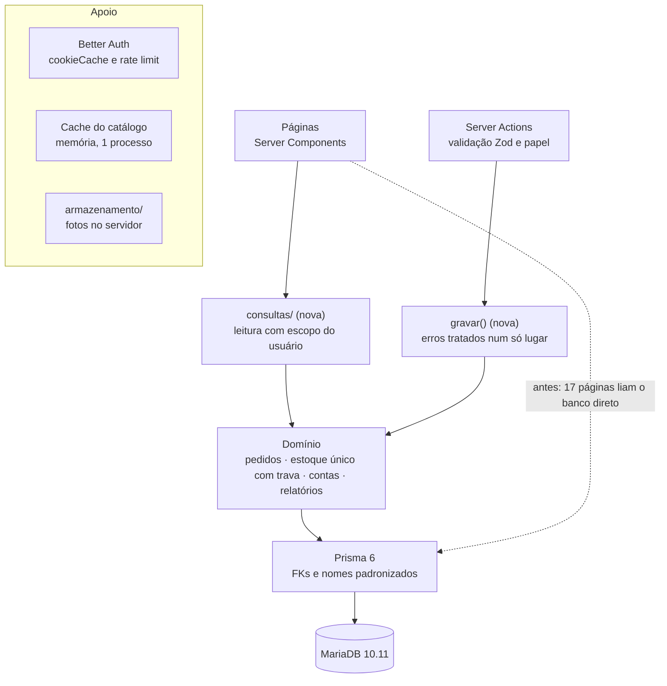

# 16 · Plano de atualizações

Análise de 02/10/2026 · Marcelo · versão viva: [Claude Docs](https://claude.ai/code/artifact/e3ca0a56-9590-4daf-98c8-a4dbad374c30)

> Registro da análise que originou as correções da branch `fix/fase-1-seguranca`. As linhas **Andamento** mostram o que já foi feito; o que falta para a produção está em [17 · Go-live](17-go-live.md).

## Resumo executivo

O sistema está publicado para testes e bem construído, mas tem 12 correções críticas que devem sair nas próximas 2 semanas, antes de qualquer funcionalidade nova. As três mais urgentes são: o login aceita tentativas ilimitadas de senha (C-01), valores como "1.500" são gravados como R$ 1,50 (C-05) e os backups existem só no mesmo disco do servidor (C-10).

- **Segurança:** sem limite de tentativas no login, redirecionamento aberto após login, vínculo automático de contas pelo telefone, sem cabeçalhos de segurança, app rodando como root.
- **Dados e dinheiro:** erro de leitura de valores com ponto de milhar, duas corridas de concorrência no estoque, gestor pode se desativar.
- **Operação:** 65 fotos da Hering já quebradas, memória a 95% do limite de reinício, sem CI, sem monitoramento, sem cópia externa do backup.
- **O que está bom:** arquitetura simples e coerente, permissões no servidor, custo protegido, TypeScript e ESLint sem erros, documentação completa.
- **Estrutura:** as escritas têm uma camada única de regras, mas as leituras estão espalhadas por 17 páginas, cada uma repetindo o filtro de permissão; o estoque tem duas portas de alteração com garantias diferentes.
- **Dados:** a base atual é de teste (20 clientes, 2 pedidos, nenhuma venda), o que torna este o momento mais barato para mudar o modelo de dados.

O plano abaixo organiza o trabalho em 4 fases, de "estancar riscos" a "evoluir o produto", com critério de conclusão em cada uma.

## Visão geral do projeto

O sistema é uma aplicação Next.js única (loja privada + painel interno) com cerca de 5.400 linhas, publicado como ambiente de desenvolvimento e teste (ainda não é produção) em `dcerutti.com.br` desde 28/09/2026. A base está bem organizada e documentada; os riscos concentram-se em segurança de autenticação, concorrência de estoque e operação do servidor.

| Item | Situação encontrada |
| --- | --- |
| Stack | Next.js 16.3.6, React 19.2.8, Prisma 6.19.3, Better Auth 1.7.6, Zod 4, Tailwind 4 |
| Banco no servidor | MariaDB 10.11 (a documentação e o Docker usavam MySQL 8.4) |
| Execução | PM2 (fork, 1 processo, usuário root) atrás do Nginx do aaPanel |
| Caminho real | `/www/wwwroot/dcerutti/site` (os scripts de `deploy/` apontavam para `/srv/dcerutti`) |
| Servidor | 2 vCPU, 7,9 GB RAM, sem swap; disco 56% usado |
| Memória do app | 664 MB RSS, com limite de reinício em 700 MB; heap em 97% |
| Backup | Cron diário às 03:00, dumps locais de 7 dias presentes |
| Qualidade | `tsc` sem erros, ESLint sem avisos, 22 testes de unidade passando |
| Testes E2E | Existem (Playwright), mas não rodam em CI |
| CI | Não ativado (`deploy/github-ci.yml` parado) |
| Git | Repositório com 7 commits, árvore limpa; Git recusa operar sem `safe.directory` (dono diferente) |
| Dados (teste, 02/10) | 1 gestor, 3 vendedores, 20 clientes (todos com conta); 583 produtos e 1.162 tamanhos; 2 pedidos (1 pendente, 1 cancelado); nenhuma venda nem movimentação de estoque; tabela de configurações vazia (vale o padrão do código); 46 sessões abertas |
| Repositório | Público no GitHub (marcelo-braga-dev/dcerutti), com o README listando usuários e senha padrão do seed (C-12) |

Pontos fortes que devem ser preservados: regras de permissão centralizadas em `src/server/permissoes.ts`, custo isolado de clientes e vendedores, reserva de estoque com `UPDATE … WHERE estoque - reservado >= qtd`, datas no fuso de São Paulo e uma documentação de 15 capítulos acima da média.

## Análise estrutural

A arquitetura de um único app Next.js com Server Actions é adequada ao porte da loja e não precisa ser trocada. O problema estrutural é a assimetria: toda escrita passa por uma camada única com validação e permissão, mas as leituras não. 17 páginas consultam o Prisma diretamente e repetem o filtro de permissão à mão em 18 pontos.

| Área | Situação atual | Risco | Mudança proposta |
| --- | --- | --- | --- |
| Camada de leitura | 17 páginas importam `db`; `escopoVendedor`/`podeAcessar` aplicados manualmente em cada uma | Uma página nova sem o filtro mostra clientes e pedidos de outro vendedor | Pasta `src/server/consultas/` por domínio: recebe o usuário e aplica o escopo internamente; páginas deixam de importar `db` (regra de ESLint `no-restricted-imports`) |
| Regras de estoque | Reserva e baixa ficam em `server/pedidos.ts`; ajuste e entrada ficam em `acoes/produtos.ts`, com garantias diferentes | Duas portas para o estoque, uma sem trava (C-06) | Módulo único `server/estoque.ts` (reservar, baixar, liberar, ajustar), sempre com `UPDATE` condicional e registro em `movimento_estoque` |
| Tratamento de erros | As actions misturam `return falha()`, `throw new Error`, `.catch(e => e)` e retornos silenciosos | Mensagens inconsistentes e erro 500 em casos previsíveis | Um tipo de resultado único e um helper que converte `ErroNegocio`, `P2002` e `P2003` em mensagem para o usuário |
| Modelo de dados | `pedido.vendedorId`, `venda.vendedorId` e `movimento_estoque.usuarioId` sem chave estrangeira; e-mail guardado em `cliente` e em `user`; telefone sem forma normalizada; `configuracao` como JSON livre; nomes mistos (`createdAt` e `criadoEm`) | Registros órfãos, duas fontes de verdade, buscas por telefone em JavaScript | Migration com as FKs, telefone normalizado, config validada por Zod, convenção única de nomes nas tabelas novas |
| Venda e pedido | Venda manual não tem itens; resultados por categoria e produto ignoram essas vendas | Lucro por categoria parcial, sem aviso claro | Itens opcionais na venda manual, ou rótulo "não detalhado" nos relatórios |
| Carga no navegador | `/painel/pedidos/novo` envia ao navegador todo o catálogo em estoque e todos os clientes | Página cresce junto com o catálogo e a carteira | Busca no servidor |
| Duplicação | Busca sem acento reimplementada em `montador.tsx`; mapa de nomes da equipe consultado em 4 páginas; 24 cores hexadecimais fixas fora do `globals.css` | Regras e visual divergem com o tempo | Reusar o helper de busca de `lib/catalogo.ts`, trocar as cores por tokens da marca |
| Sessão | Cada requisição faz 2 consultas (sessão do Better Auth + usuário) | Carga extra em toda página | `session.cookieCache` curto (5 min), mantendo a checagem de `ativo` |
| Métrica enganosa | A ficha do cliente mostra "Total comprado" somando só as últimas 20 vendas | Decisão comercial com número errado | Agregar com `_sum` no banco |

Arquitetura-alvo: as caixas `consultas/` e `gravar()` são as camadas novas; a seta pontilhada é o caminho que existia e deve desaparecer.

Com as consultas centralizadas, a regra "vendedor só vê o que é dele" passa a existir em um único lugar e pode ser coberta por testes.

## Correções críticas

Doze problemas exigiam correção antes de qualquer melhoria: cinco de segurança, quatro de dados ou dinheiro e três de operação. Todos foram verificados no código ou no servidor em 02/10/2026.

**Andamento em 02/10:** C-01, C-02, C-03, C-04, C-05, C-06, C-07, C-09 e C-12 foram corrigidos na branch `fix/fase-1-seguranca` e estão rodando no servidor de teste. No C-10, os dumps agora só podem ser lidos pelo root; a cópia externa saiu do escopo por decisão da loja. Pendente: C-11 (app sem root).

**Fase 2:** páginas de erro em todas as áreas; `gravar()` para erros previsíveis do banco; camada `src/server/consultas/` (nenhuma página importa mais `db`, garantido por regra do ESLint); módulo único `src/server/estoque.ts`; configurações validadas por Zod; rota `/api/saude`; cache de sessão do Better Auth; "Total comprado" calculado no banco.

**Estrutura:** chaves estrangeiras aplicadas no banco (migration `20261002120000_chaves_estrangeiras`); telefone gravado sempre no mesmo formato; busca de peças do "Novo pedido" feita no servidor; cores fixas trocadas pela paleta da marca; "Carregar mais" em pedidos e clientes; CI em `.github/workflows/ci.yml` com MariaDB 10.11; Docker local alinhado ao servidor (decisão D-12).

**Fotos (C-08), decisão D-13:** sem bucket. Os arquivos ficam no próprio servidor, em `armazenamento/` dentro do projeto, servidos por `/arquivos/...`. O upload converte para WebP de até 1600 px, o SDK da AWS saiu do projeto e `npm run fotos:migrar` baixou 2.177 fotos da Hering e da Dafiti para o servidor; as 235 que não existiam mais foram removidas. Ações rápidas (excluir venda, remover tamanho, reativar vendedor) mostram o erro na tela, e a exclusão de produto apaga também os arquivos.

| # | Problema | Onde | Impacto | Correção proposta |
| --- | --- | --- | --- | --- |
| C-01 | Login sem limite de tentativas: a Server Action chama `auth.api.signInEmail` direto, o que contorna o rate limit do Better Auth (só vale para as rotas HTTP) | `src/server/acoes/conta.ts` | Força bruta de senhas de gestor e vendedores | Limitar por IP + e-mail, bloqueio temporário; IP real do Nginx no Better Auth |
| C-02 | Redirecionamento aberto no `volta`: `/\site-falso.com` passava no filtro `startsWith('/') && !startsWith('//')` e o navegador trata como `//site-falso.com` | `src/server/acoes/conta.ts` | Phishing após login legítimo | Aceitar só caminhos internos e validar com `new URL(volta, base).origin === base` |
| C-03 | Cadastro vinculava a conta nova a qualquer ficha sem login com o mesmo WhatsApp | `src/server/acoes/conta.ts` | Quem soubesse o telefone de um cliente veria o histórico de pedidos, endereço e preferências dele | Não vincular automaticamente |
| C-04 | Sem cabeçalhos de segurança (só HSTS); `X-Powered-By: Next.js` exposto; Nginx aceitava TLS 1.1 e 3DES | Nginx do aaPanel + `next.config.ts` | Clickjacking do painel, vazamento de referência, nota baixa em auditorias | `poweredByHeader: false`; CSP, `X-Frame-Options: DENY`, `Referrer-Policy`, `Permissions-Policy`, `X-Content-Type-Options`; TLS 1.2+ |
| C-05 | `lerValor('1.500')` devolvia 1,5 (ponto tratado como decimal quando não há vírgula) | `src/lib/dinheiro.ts` | Meta, preço, custo ou venda manual gravados 1.000× menores sem aviso | Ponto seguido de grupos de 3 dígitos é milhar; testes de unidade |
| C-06 | Ajuste de estoque lia e gravava sem trava (`findUnique` + `update`) | `src/server/acoes/produtos.ts` | Uma venda confirmada ao mesmo tempo era sobrescrita e o estoque ficava errado | `SELECT … FOR UPDATE` no módulo único de estoque |
| C-07 | Fechamento de pedido só conferia `status` lido sem trava; num condicional devolvido inteiro, dois cliques liberavam a reserva duas vezes | `src/server/pedidos.ts` | Reservas de outros condicionais liberadas por engano | Primeiro `UPDATE pedido SET status=… WHERE id=? AND status='pendente'` e abortar se 0 linhas; idem no cancelamento |
| C-08 | Todas as 2.412 fotos do banco apontavam para servidores da Hering e da Dafiti, e 65 já retornavam 404 | `produto_imagem` + `src/lib/imagens.ts` | Catálogo com fotos quebradas | Fotos no próprio servidor (D-13) |
| C-09 | Gestor podia desativar a si mesmo ou outro gestor | `src/server/acoes/gestao.ts` | Loja sem nenhum gestor ativo | Exigir `papel: 'vendedor'` e impedir `id === u.id` |
| C-10 | Backups só no mesmo disco e legíveis por todos (`644`) | `/var/backups/dcerutti` | Perda total se o disco falhar; dados pessoais expostos a outros usuários do servidor | `umask 077`; cópia externa fora do escopo por decisão da loja |
| C-11 | App roda como `root` (PM2) e arquivos são de `root` | PM2 / sistema | Uma falha no Next ou numa dependência vira controle total do servidor | Usuário de sistema próprio; Node fora do `/root` |
| C-12 | Repositório público no GitHub com o README listando os usuários do seed e a senha padrão; o seed só se recusava a rodar se `NODE_ENV=production`, que o `.env` do servidor não define | `README.md`, `scripts/seed.ts`, `.env` | Verificado em 02/10: o banco não tem usuários `@dcerutti.local`. O risco era um seed rodado por engano criar um gestor com senha pública | `SEED_SENHA` obrigatória, seed só em banco local com `SEED_PERMITIDO=1`, senhas fora do README |

Também há 3 vulnerabilidades "high" no `npm audit` (`deepmerge-ts` via `prisma` CLI). São de ferramenta de desenvolvimento e não chegam ao runtime, mas devem sumir na atualização do Prisma.

## Robustez e qualidade de código

**Tratamento de erros**

- [x] `error.tsx` em loja, painel e conta, mais `global-error.tsx` e `loading.tsx` no painel.
- [x] Violação de unicidade (`P2002`) e chave estrangeira (`P2003`) tratadas num helper único (`gravar()`).
- [x] `desativarVendedor` conta e transfere clientes na mesma transação.
- [x] `excluirVenda`, `removerVariante` e `reativarVendedor` devolvem mensagem quando recusam.

**Validação e regras**

- [ ] Senha mínima de 8 caracteres para todos (hoje 6 para clientes).
- [ ] Só o gestor troca a senha de um cliente; registrar quem trocou.
- [x] Cadastro não carrega mais todas as fichas para comparar telefone.
- [ ] Validar ids com `z.cuid()` nas actions que recebem ids por parâmetro.
- [ ] Expirar reservas de condicionais pendentes após N dias, com aviso ao vendedor.

**Integridade do banco**

- [x] Chaves estrangeiras de `pedido.vendedorId`, `venda.vendedorId`, `movimento_estoque.usuarioId` e `pedidoId`.
- [ ] Tabela de auditoria para preço, custo, senha, configurações e cancelamentos.
- [x] `lerConfig` valida o JSON salvo com Zod e cai no padrão se vier corrompido.

**Testes**

- [ ] Testes de integração das regras de `server/pedidos.ts` e `server/estoque.ts` contra MariaDB.
- [ ] Testes de permissão: vendedor tentando ler ou alterar dados de outro vendedor; cliente chamando actions da equipe.
- [ ] Medir cobertura e exigir mínimo em `src/server` e `src/lib`.

**Organização**

- [x] MariaDB 10.11 no servidor, no Docker e no CI (D-12).
- [x] Scripts de `deploy/` usam o caminho real do projeto.
- [x] Arquivos do aaPanel no `.gitignore`.

## Performance, SEO e acessibilidade

**Performance**

- [ ] Memória: o processo passa do limite de reinício (ver B-02 em [17 · Go-live](17-go-live.md)). Investigar com heapdump, subir o limite para ~1,2 GB e criar swap.
- [x] Paginação em Pedidos e Clientes, com contagem total.
- [ ] Índice de busca em clientes e pedidos quando passar de alguns milhares de linhas.
- [ ] Somas dos relatórios no banco quando o histórico crescer.

**SEO (para quando o catálogo abrir, D-09)**

- [ ] `robots.ts` e `sitemap.ts`; Open Graph por produto; JSON-LD `Product`; URLs canônicas no catálogo filtrado.

**Acessibilidade**

- [ ] Abas "Comprar / Provar em casa" com o padrão ARIA completo.
- [ ] Modal "Ainda não chegamos aí" fechando com Esc (`<dialog>` nativo).
- [ ] Trocar `confirm()` do navegador por diálogo próprio.
- [ ] Rodar axe/Lighthouse nas 6 telas principais.

**Experiência do usuário**

- [ ] `manifest.webmanifest` e ícones para instalar o painel no celular.

## Infraestrutura, DevOps e profissionalização

**Entrega contínua**

- [x] CI em `.github/workflows/ci.yml` com MariaDB, migrations e build (falta o push).
- [ ] Proteção da branch `main` e atualização semanal de dependências.
- [ ] Deploy atômico com volta à versão anterior em um comando.
- [ ] Ambiente de homologação separado.

**Monitoramento e logs**

- [x] Rota `/api/saude` que confere o banco.
- [ ] Monitor externo com alerta; rastreamento de erros; alerta de disco, memória e certificado.

**Servidor e segurança operacional**

- [ ] Usuário de sistema próprio para o app (C-11).
- [ ] Trocar segredos expostos e documentar a rotação.
- [x] Nginx só com TLS 1.2/1.3 e cifras modernas.
- [ ] `limit_req` no Nginx; usuário do banco com permissões mínimas.

**Produto e negócio**

- [ ] Recuperação de senha por e-mail, com SPF, DKIM e DMARC.
- [ ] Aviso ao vendedor quando entrar pedido.
- [ ] Política de privacidade e consentimento LGPD.
- [ ] Decidir P-03 (frete) e P-04 (parcelamento).
- [ ] Importação de estoque por planilha (P-05).

## Roadmap priorizado

A fase 1 era a única urgente: fechava os riscos de segurança e de perda de dados em cerca de 5 dias de trabalho. Datas e esforços estimados para um desenvolvedor em meio período.

| Fase | Período | Esforço | Conteúdo | Critério de saída |
| --- | --- | --- | --- | --- |
| 1 · Estancar riscos | 5 a 16/10 | ~5 dias | C-01, C-02, C-05, C-09, C-04, C-11, C-10, C-12 | Testes de C-01, C-02 e C-05 passando |
| 2 · Robustez | 19/10 a 6/11 | ~8 dias | C-03, C-06, C-07, CI com MariaDB e E2E, páginas de erro, `consultas/`, estoque único, FKs, memória | CI verde obrigatório na `main`, alerta de queda testado |
| 3 · Profissionalizar | 9/11 a 4/12 | ~10 dias | Fotos no servidor (C-08), deploy atômico, homologação, recuperação de senha, LGPD, auditoria, paginação, acessibilidade | Nenhuma foto externa; redefinição de senha funcionando |
| 4 · Evoluir o produto | A partir de 7/12 | Contínuo | Importação de estoque, aviso de pedido, expiração de condicionais, PWA, catálogo público com SEO | — |

Boa parte das fases 1 a 3 já foi entregue (ver **Andamento** acima). Cada fase só termina quando o critério de saída está comprovado; itens não concluídos passam para a fase seguinte.
