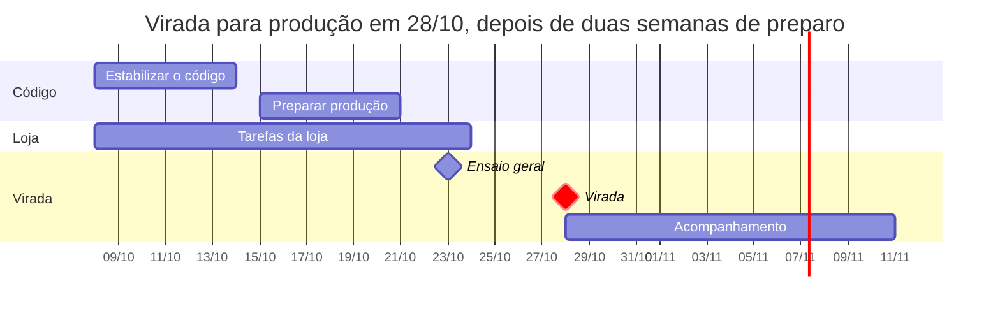

# 17 · Go-live: o que falta para produção

> Registro histórico. Substituído por [19 · Lançamento](19-lancamento.md) em 08/10/2026; a situação atual de cada item está lá.

Análise de 07/10/2026 · Marcelo · versão viva: [Claude Docs](https://claude.ai/code/artifact/5fadaa08-d7cb-41b2-9db9-ec3656577d28)

## Veredito

Ainda não dá para pôr em produção. A base de código está sólida depois das correções, mas há 10 bloqueadores. Com dedicação de meio período, o go-live realista é em cerca de 3 semanas, perto de 28/10/2026.

Os três bloqueadores mais sérios:

- **O painel nunca foi testado logado depois da refatoração.** Todas as 17 páginas mudaram de camada de consulta, e os testes ponta a ponta não rodaram.
- **O app reinicia sozinho por falta de memória.** Foram 13 reinícios entre 03/10 e 06/10, com picos de 917 MB para um limite de 700 MB. Cada reinício derruba quem está usando.
- **O domínio definitivo serve o ambiente de teste.** dcerutti.com.br tem 28 usuários e 2 pedidos de teste, e as credenciais do banco circularam em conversa. Produção precisa de banco limpo e segredos novos.

Os outros 7 são de negócio e operação: recuperação de senha, LGPD, estoque real, fotos de 82 produtos, decisões de frete e parcelamento, publicar o código e o app rodando como root.

## Andamento

Atualizado em 07/10/2026, depois do início das atualizações:

- **B-01 resolvido:** a suíte ponta a ponta (10 testes, 4 novos para o painel e a LGPD) passa contra um banco isolado (`test_dcerutti_e2e`).
- **B-02 resolvido:** o mesmo teste de carga que levava a 1.005 MB e reiniciava o app agora fica em 330 MB, sem reinício (sem AVIF, `MALLOC_ARENA_MAX=2`, limite de 1,2 GB, 2 GB de swap).
- **B-07 quase pronto:** política em `/privacidade` (minuta: falta a loja aprovar o texto), aceite no cadastro e no primeiro acesso, exclusão da própria conta.
- **B-03 pronto no código:** "Esqueci a senha" com link de uso único (1 hora), testado de ponta a ponta. Falta só configurar o provedor de e-mail (`SMTP_URL` e `EMAIL_REMETENTE`) e o SPF/DKIM/DMARC do domínio; sem isso o link vai para o log do servidor.
- **B-10 resolvido:** o app roda como o usuário de sistema `dcerutti` (sem login), com Node e PM2 em `/opt/node-22` e serviço `pm2-dcerutti` no boot; build, migrations e deploy rodam como esse usuário (`deploy/app.sh`, `deploy/pm2.sh`, `deploy/deploy.sh`). Suíte ponta a ponta (12) passando assim.
- **B-05 em parte:** variáveis do R2 removidas do `.env` (`chmod 600`, dono `dcerutti`). A troca da senha do banco e do `BETTER_AUTH_SECRET` fica para o dia da virada.
- **Código "antes do go-live" pronto:** senha mínima de 8, troca de senha encerra sessões, e-mail e senha de cliente com acesso só pelo gestor, Next 16.4.0, React 19.3.0, Better Auth 1.7.7.
- **Ambiente de teste mais leve:** fotos reduzidas a 112 arquivos repetidos (7,9 MB), com `npm run fotos:reduzir-teste`.

## O que já está pronto

A branch `fix/fase-1-seguranca` tem 9 commits à frente da `main`, ainda não enviados ao GitHub. O servidor de teste já roda essa versão.

| Área | Entregue |
| --- | --- |
| Segurança | Limite de tentativas no login e cadastro, retorno seguro após login, cabeçalhos (CSP, frame, referrer), TLS 1.2+, seed sem senha padrão, cadastro sem vínculo automático por telefone |
| Dados | Leitura de valores com milhar, travas de estoque e de pedido, chaves estrangeiras, telefone padronizado, configurações validadas |
| Estrutura | Camada `consultas/` (nenhuma página lê o banco direto), módulo único de estoque, erros do banco viram mensagem, páginas de erro, paginação |
| Fotos | 2.177 fotos no próprio servidor (WebP), upload local, 235 fotos quebradas removidas, exclusão de produto apaga os arquivos |
| Operação | `/api/saude`, CI pronto em `.github/workflows/ci.yml`, MariaDB 10.11 em todos os ambientes, scripts de deploy no caminho certo |

Verificação atual: tipos, lint, 25 testes de unidade e build passam. A exclusão de produto foi testada direto no banco.

## Bloqueadores de produção

Nenhum destes pode ficar para depois do go-live. Todos foram verificados no código, no banco ou no servidor em 07/10.

| # | Bloqueador | Evidência | O que fazer | Esforço |
| --- | --- | --- | --- | --- |
| B-01 | Painel sem teste logado após a refatoração | 17 páginas trocaram de camada; testes ponta a ponta nunca rodaram | Rodar os testes ponta a ponta num banco de teste e fazer um roteiro manual com gestor, vendedor e cliente | 1 dia |
| B-02 | Reinícios por memória | 13 reinícios entre 03/10 e 06/10 no log do PM2, picos de 917 MB; servidor sem swap | Medir com heapdump (suspeito: otimizador de imagens); subir o limite para 1,2 GB, criar 2 GB de swap, limitar a concorrência do `sharp` | 1 dia |
| B-03 | Sem recuperação de senha | Nenhum provedor de e-mail; só o gestor redefine senhas | Provedor de e-mail transacional (Resend, Brevo ou SMTP do domínio), fluxo "Esqueci a senha" do Better Auth, SPF/DKIM/DMARC | 1,5 dia |
| B-04 | Domínio definitivo servindo teste | 28 usuários e 2 pedidos de teste em dcerutti.com.br; `CLAUDE.md` marca o servidor como teste | Decidir: banco de produção novo, ou limpar o atual (manter catálogo, apagar contas, pedidos e sessões de teste). Mover o teste para um subdomínio | 0,5 dia |
| B-05 | Segredos expostos | Senha do banco colada em conversa; chaves do R2 sem uso ainda no `.env` | Trocar a senha do banco e o `BETTER_AUTH_SECRET` (derruba as sessões atuais), apagar as variáveis do R2, `chmod 600` no `.env` | 0,5 dia |
| B-06 | Código não publicado | `main` no GitHub está 9 commits atrás; o CI nunca rodou | Push da branch (token com escopo `workflow`), pull request, CI verde e merge na `main` | 0,5 dia |
| B-07 | LGPD | Cadastro coleta nome, WhatsApp, endereço e e-mail sem política de privacidade nem consentimento | Página de privacidade e termos, aceite no cadastro, exclusão de conta a pedido | 1 dia |
| B-08 | Estoque não é o real | Os 583 produtos e as quantidades vieram do protótipo (P-05) | Contagem ou importação do estoque atual da loja antes de abrir para clientes | 1–2 dias (loja) |
| B-09 | Decisões de negócio abertas | O site promete frete grátis acima de R$ 299 e "6x"; tabela de configurações vazia (vale o padrão do protótipo, inclusive o WhatsApp da loja) | Responder P-03 (frete) e P-04 (parcelas) e salvar Configurações no painel com os dados reais | 0,5 dia |
| B-10 | App rodando como root | PM2 e arquivos do projeto são do root; o Node está em `/root/.nvm` | Usuário de sistema próprio, Node fora do `/root`, PM2 desse usuário | 0,5 dia |

## Correções e melhorias de código

Nenhum item desta seção impede o go-live sozinho. Os quatro primeiros devem entrar antes, porque são baratos e fecham riscos reais.

**Antes do go-live**

- [ ] Senha mínima de 8 caracteres para todos. Hoje é 6 para clientes (`src/server/auth.ts:11`, `acoes/conta.ts:50`, `acoes/clientes.ts:22`).
- [ ] Trocar a senha encerra as outras sessões do usuário. Hoje só desativar vendedor faz isso.
- [ ] Só o gestor troca a senha de um cliente. Hoje o vendedor também pode e, com isso, entrar como o cliente (`acoes/clientes.ts:57`).
- [ ] Atualizar para as versões de correção: Next 16.4.0, React 19.3.0, Better Auth 1.7.7.

**Primeiro mês**

- [ ] Testes de integração da camada `consultas/` e de `estoque.ts` contra MariaDB: vendedor não enxerga cliente de outro, duas reservas da última peça, fechamento duplo. Hoje há só 3 arquivos de teste de unidade, todos de `lib/`.
- [ ] Condicionais pendentes seguram estoque para sempre: expirar a reserva após N dias, configurável, com aviso ao vendedor.
- [ ] Registro de auditoria (quem, quando, o quê) para preço, custo, senha, configurações e cancelamentos.
- [ ] Aviso ao vendedor quando entra pedido (e-mail ou notificação), aproveitando o provedor de e-mail do B-03.

**Depois**

- [ ] Venda manual com itens opcionais, para os relatórios por categoria ficarem completos.
- [ ] Acessibilidade: abas da sacola, modal sem Esc, `confirm()` nativo; rodar Lighthouse nas 6 telas principais.
- [ ] Instalar o painel no celular (manifest e ícones).
- [ ] Se o catálogo abrir ao público: `robots.ts`, `sitemap.ts`, Open Graph e dados estruturados de produto. Hoje nenhum existe, o que está certo enquanto ele for privado.
- [ ] Prisma 7 quando o adaptador de driver estabilizar; resolve os 3 alertas "high" do `npm audit`, todos da ferramenta de linha de comando.

## Infraestrutura de produção

O servidor aguenta a loja com folga (2 vCPU, 7,9 GB, disco 56% usado). O que falta é separar teste de produção e saber quando algo cai.

**Ambientes**

- [ ] Produção em dcerutti.com.br com banco próprio e `.env` próprio (`NODE_ENV=production`, segredos novos). Teste em um subdomínio, como `teste.dcerutti.com.br`, com outro banco, outra porta e outro processo no PM2.
- [ ] Atualizar o `CLAUDE.md` e a memória do projeto quando o servidor virar produção: hoje eles autorizam build e reload livres aqui.

**Deploy**

- [ ] Usar `deploy/deploy.sh` a partir da `main` (pull, `npm ci`, migrations, build, reload), nunca editar o servidor à mão.
- [ ] Build em pasta separada e troca atômica, com volta à versão anterior em um comando. Hoje o build sobrescreve a `.next` em uso.

**Servidor**

- [ ] 2 GB de swap e limite de memória do PM2 em 1,2 GB (ver B-02).
- [ ] Fechar portas que a loja não usa: FTP (20 e 21) e o painel do aaPanel (888) estão abertos para a internet no firewall. Acesso ao painel por túnel SSH ou IP fixo.
- [ ] `limit_req` no Nginx para `/entrar`, `/cadastro` e `/api/auth`, somando ao limite do app.
- [ ] Usuário do banco só com `SELECT/INSERT/UPDATE/DELETE` para o app; outro, com `ALTER`, só para migrations.
- [ ] Conferir a renovação automática do certificado: o atual vence em 27/12/2026.

**Monitoramento**

- [ ] Monitor externo (UptimeRobot ou Better Stack) em `https://dcerutti.com.br/api/saude`, que já existe, com alerta por WhatsApp ou e-mail.
- [ ] Rastreamento de erros (Sentry ou similar). Hoje os erros só aparecem no log do PM2, e os 13 reinícios por memória passaram sem ninguém saber.

**Backup**

A cópia externa ficou fora do escopo por decisão da loja. Hoje existem só os dumps diários do banco, guardados 7 dias no mesmo disco, e a pasta `armazenamento/` (210 MB de fotos) não tem backup nenhum. Se o disco falhar, perde-se tudo. Vale rever essa decisão antes de ter dados reais de clientes e vendas.

## Negócio e conformidade

Metade do caminho até a produção depende da loja, não do código. Estas respostas e tarefas têm de vir da D'Cerutti.

| Item | Situação hoje | Quem decide ou faz |
| --- | --- | --- |
| P-03 Frete | O site mostra R$ 24,90, grátis acima de R$ 299 (valor do protótipo) | Loja |
| P-04 Parcelamento | A página do produto mostra "ou 6x de"; ninguém confirmou se é real | Loja |
| P-05 Estoque | Quantidades do protótipo; precisa de contagem ou importação da loja | Loja + desenvolvimento |
| WhatsApp da loja | Configurações nunca foram salvas; vale o número padrão do protótipo | Gestor, no painel |
| Fotos | 82 produtos sem nenhuma foto depois da limpeza | Loja (fotografar) + gestor (enviar no painel) |
| Equipe real | 1 gestor e 3 vendedores no banco de teste | Criar o gestor definitivo com `npm run criar-gestor` e cadastrar os vendedores reais com WhatsApp completo |
| Política de privacidade e termos | Não existem (B-07) | Loja aprova o texto; desenvolvimento publica |
| Treinamento | [12 · Guia de uso](12-guia-de-uso.md) existe | Sessão curta com gestor e vendedores antes da virada |
| Divulgação | Link de convite de cada vendedor já funciona | Vendedores enviam o convite aos clientes no dia da virada |

Sobre LGPD: o sistema guarda nome, WhatsApp, endereço, e-mail e histórico de compras. O mínimo antes de abrir é publicar a política, registrar o aceite no cadastro e ter um jeito de atender pedido de exclusão de dados.

## Plano até o go-live

A virada fica em 28/10/2026, cinco dias depois de um ensaio geral em 23/10/2026. As datas são estimativas e dependem das tarefas da loja (estoque, fotos, decisões) andarem em paralelo.

| Frente | Itens |
| --- | --- |
| Estabilizar o código | B-01, B-02, B-06 e os 4 itens "antes do go-live" |
| Preparar produção | B-03, B-07, B-10, swap, portas, monitor externo e rastreamento de erros |
| Tarefas da loja | B-08, B-09, fotos dos 82 produtos, equipe real |
| Ensaio geral | Banco limpo no ambiente de teste, roteiro completo com gestor, vendedor e cliente reais |

**Checklist do dia da virada**

- [ ] Banco de produção limpo: catálogo e estoque reais, sem contas, pedidos nem sessões de teste
- [ ] Segredos novos no `.env` de produção e `NODE_ENV=production`
- [ ] `deploy/deploy.sh` a partir da `main` com CI verde
- [ ] Gestor definitivo criado com `npm run criar-gestor`; vendedores reais cadastrados
- [ ] Configurações salvas no painel (WhatsApp da loja, frete, parcelas, CEPs do condicional)
- [ ] Monitor externo em `/api/saude` e alerta testado
- [ ] Um pedido e um condicional de verdade, do cadastro até a confirmação no painel
- [ ] Teste movido para o subdomínio e `CLAUDE.md` atualizado
- [ ] Vendedores enviam o link de convite aos clientes
