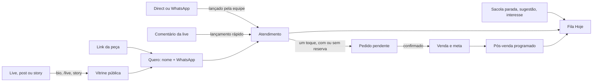

# 26 · Atendimento online e Vitrines (lives e feed)

Planejamento de 08/11/2026 · Marcelo · situação: **Fases 1A, 1B, 2, 3 e 5 prontas** (números da loja, atendimento, envio de peça, vitrines e pós-venda). A **Fase 4 (Lives) foi retirada do escopo** em 09/11/2026, por decisão da loja. Falta na Fase 0: e-mail, cron na produção e teste nos aparelhos reais.

O proprietário quer **vendedoras online**, que atendem pelo WhatsApp e pelo Direct, enviam fotos, vídeos, valores e tamanhos, retomam clientes interessadas, ajudam a fechar pedidos, fazem o pós-venda e participam das lives. Este capítulo descreve a estrutura que o sistema precisa ter para apoiar esse trabalho.

**Definido pela loja em 08/11/2026 (D-30 e D-31):** todas as vendedoras têm a estrutura; **os números de WhatsApp pertencem à loja**, e a gestora cadastra cada um e define quem o usa; a cliente com ficha fica com a **própria vendedora**; e a **gestora acompanha tudo**.

## A ideia em uma frase

As conversas continuam no WhatsApp e no Instagram; o sistema diz **quem atender, o que enviar e quando retomar**, e liga cada conversa, live e publicação às vendas que ela gerou.

São dois módulos que se encaixam:

- **Atendimento:** a fila de trabalho da vendedora. Cada oportunidade tem etapa, próximo contato e histórico.
- **Vitrines:** uma página pública com as peças de uma live ou publicação do feed, com o link do Instagram e, na live, o roteiro. Cada pedido feito pela vitrine vira um atendimento.

## Escopo

**Entra:**

- cadastro dos números da loja, vínculo com a equipe por arrastar e soltar, e histórico de quem usou cada número;
- fila "Hoje", atendimentos, etapas, retornos, notas e respostas prontas;
- link público de uma peça, com fotos, vídeos, preço e tamanhos;
- vitrines de live e de feed, com link do Instagram, página na bio e `/live`;
- pós-venda programado, consentimento, resultados por vitrine e por vendedora.

**Não entra agora:**

| Fora do escopo | Motivo |
|---|---|
| Roteiro da live, tela ao vivo, lançamento rápido dos comentários e reserva com prazo (Fase 4) | Retirados em 09/11/2026, por decisão da loja. As seções sobre eles ficam só como registro. A vitrine de live continua: agendar, iniciar, encerrar e `/live` |
| Integração com a live ou os comentários da Meta | Decisão da loja em 08/11/2026. Os comentários são lidos e lançados à mão |
| API do WhatsApp ou do Instagram, caixa de conversas | Continua valendo a D-08. Reavaliar com os dados de uso ([ver abaixo](#evolução-futura-api-oficial)) |
| Robô ou resposta automática | A função é de uma pessoa, e os envios seguem manuais |
| Vídeo incorporado do Instagram | Exige script de terceiro na CSP. A página leva ao Instagram por link |
| Pagamento online e rastreio de transportadora | Dependem de definições da loja (P-03). Aqui, só o registro manual |

## O que já existe e será reaproveitado

| Peça | Uso neste módulo |
|---|---|
| Sugestões (`src/server/sugestoes.ts`, D-27) | Oferta a uma cliente com ficha; continua igual e passa a poder sair de um atendimento |
| Link assinado e cartão (`src/server/link-pedido.ts`, `src/server/cartao-pedido.ts`) | Modelo para o link da peça e o cartão de prévia das vitrines |
| `criarPedido` com `precos` (`src/server/pedidos.ts:51`) | Converte o atendimento em pedido com o preço combinado |
| `reservar` e `liberarReserva` (`src/server/estoque.ts`) | Reserva da live, com o mesmo `UPDATE` condicional do condicional |
| Interesse (`src/server/consultas/navegacao.ts`) | Alimenta a fila "Hoje" e sugere peças para a live |
| Notificações (`src/server/notificacoes.ts`, D-28) | Novos avisos, sem criar outro mecanismo |
| Acompanhamento (`src/lib/equipe.ts`, D-26) | Novas ações da equipe |
| Vídeos (`ProdutoVideo`, D-29) e `/arquivos` públicos | Mídia nos links públicos |
| `limite.ts`, `data-acao` e compartilhar do celular | Limite de tentativas, registro de cliques e envio de imagem |

## Limites do código atual que moldam a solução

Foram conferidos no código em 08/11/2026.

1. **Contato do Direct não pode virar ficha sem telefone.** `telefone: ''` significa ficha excluída ou "Consumidor final" (`SEM_EXCLUIDOS` em `src/server/consultas/clientes.ts:9`), e `criarPedido` exige telefone. Por isso o contato só com `@` fica no **atendimento**, e a ficha nasce quando houver WhatsApp.
2. **Pedido de compra não reserva estoque** (RN-07). A live precisa de uma reserva com prazo.
3. **Cache do catálogo fica na memória do processo** (D-11). Uma rotina em processo separado não o invalida, então liberar reservas precisa rodar **dentro do app** ([ver Rotinas](#rotinas-agendadas)).
4. **Vendedor só enxerga a própria carteira** (`escopoVendedor`). Uma mensagem pode chegar a um número de quem não atende aquela cliente; a escolha de quem responde fica no [encaminhamento](#encaminhamento-pela-carteira).
5. **Enviar arquivos é só do gestor** (`src/app/api/upload/route.ts:8` e `upload/video/route.ts:11`). HEVC, padrão do iPhone, é recusado, e o servidor não tem ffmpeg.
6. **Loja exige login** (D-09), e `/produto/...` fica dentro do layout protegido. Páginas públicas ficam fora do grupo `(loja)`, como `/p` e `/s`.
7. **Avisos ainda não são confiáveis neste servidor.** `SMTP_URL` está vazio e o cron de manutenção documentado não está instalado.
8. **Pedidos vão ao telefone gravado no usuário da vendedora** (RN-03, `user.telefone`), e a loja não controla esse número. Muda com os [números da loja](#números-de-whatsapp-da-loja).
9. **Limites do Instagram.** Links em legendas e comentários em geral não são clicáveis, por isso a estrutura usa a bio, os stories, o Direct e um endereço curto. O Direct não aceita texto pré-preenchido confiável, por isso o botão copia a mensagem e abre a conversa. Conferir em iPhone e Android na Fase 3.

## Como tudo se liga



**Regra central:** a página pública **nunca cria pedido nem reserva**. Ela registra um pedido de atendimento, e só a equipe cria o pedido. Assim, robôs ou brincadeiras não prendem estoque, um telefone digitado não dá acesso a uma ficha (C-03), e a última peça fica com a primeira da fila, conferida na hora da conversão.

## Módulo Atendimento

### Telas

| Tela | O que faz |
|---|---|
| **Hoje** (`/painel/atendimento`) | A fila do dia, em ordem de urgência (abaixo) |
| **Atendimentos** (`/painel/atendimento/lista`) | Quadro por etapa e lista, com filtros de canal, responsável, vitrine e período |
| **Detalhe** (`/painel/atendimento/[id]`) | Contato, peças, histórico, próximo contato, ações e o interesse da cliente, se houver ficha |
| **Novo rápido** (na barra "+ Novo") | Nome **e** WhatsApp ou `@`, canal e peças opcionais. Meta: registrar em 15 segundos no celular |
| **Respostas prontas** (`/painel/atendimento/respostas`) | Modelos da loja e pessoais |
| **Ficha da cliente** | Novo cartão "Atendimentos"; o histórico une notas e pedidos |

### Fila "Hoje"

| Ordem | Item | Origem |
|---|---|---|
| 1 | Reserva vencendo nos próximos 30 min | Pedido com `reservaAte` |
| 2 | Atendimento novo sem primeiro contato | `Atendimento` |
| 3 | Retorno vencido ou de hoje | `proximoContatoEm` |
| 4 | Pedido pendente aguardando pagamento | `Pedido` |
| 5 | Sacola parada e interessadas | `interessadosAgora` |
| 6 | Sugestão que precisa de atenção | Regras das Sugestões |
| 7 | Pós-venda de hoje | `PosVendaContato` |

Cada item tem botões de **WhatsApp**, **Direct** (copia e abre), **Enviar peça**, **Reagendar** e **Concluir**. A consulta junta as fontes em `src/server/consultas/atendimento.ts`, com limite por grupo, sem gravar uma cópia da fila.

### Etapas

`novo → em_conversa → proposta → aguardando_pagamento → ganho`, ou `perdido`, de qualquer etapa aberta.

- **Toda conversa aberta precisa de um próximo contato.** Sem data, o atendimento não sai de `novo`.
- **Motivo obrigatório ao perder:** preço, tamanho, sem estoque, frete, desistiu, sem resposta, outro.
- `aguardando_pagamento` e `ganho` são definidos pelo pedido:
  - criar o pedido → `aguardando_pagamento`;
  - confirmar → `ganho`;
  - cancelar ou desfazer a venda → volta para `em_conversa`, com aviso.
- A função `sincronizarAtendimento(pedidoId)` é chamada ao confirmar, cancelar e desfazer, depois do commit. Falhar nela não pode impedir a venda.

### Do contato ao pedido

1. O contato tem nome e `@` ou WhatsApp.
2. Se só houver `@`, a tela lembra de pedir o WhatsApp.
3. Com o WhatsApp informado, o sistema procura a ficha pelo telefone, nos dois formatos, como o cadastro já faz. Se a ficha for da própria vendedora, ela vincula; se for de outra, o atendimento segue o [encaminhamento](#encaminhamento-pela-carteira); se não houver, cria uma ficha só com os dados digitados.
4. **Converter em pedido** abre as peças do atendimento, com tamanho e preço, e oferece compra ou condicional, com ou sem reserva.
5. A conversão é protegida contra clique duplo: `Atendimento.pedidoId` é único e a gravação só vale se ainda estiver vazio.

### Quem pode ver o quê (D-30)

Não há papel nem marcação nova: **todo `vendedor` tem a estrutura**, e o gestor vê e acompanha tudo.

| Ação | Vendedora | Gestora |
|---|---|---|
| Ver atendimentos e fila | Os dela | **Todos**, com filtro por vendedora |
| Consultar de quem é um contato | WhatsApp ou `@` exatos: só primeiro nome da cliente e a vendedora | Tudo |
| Abrir ficha de outra carteira | Não | Sim |
| Criar e publicar vitrines, conduzir live | Sim | Sim |
| Lançar pedidos na live de outra responsável | Sim, a venda segue a regra da carteira | Sim |
| Adicionar fotos e vídeos à peça | Sim, sem mudar preço ou estoque | Sim |
| Transferir atendimento ou cliente | Não | Sim |
| Cadastrar números e vincular pessoas | Não; vê só os números dela | Sim |
| Registrar nota em qualquer atendimento | Só nos dela | Sim |

As regras ficam em `src/server/permissoes.ts` (`escopoAtendimento`, `podeAtender`, com base em `escopoVendedor`), e as leituras, em `consultas/`. `desativarVendedor` passa a transferir também os atendimentos abertos. A consulta exata de contato tem limite por minuto e fica registrada no Acompanhamento, para não servir de varredura da carteira alheia.

**Visão da gestora** (`/painel/atendimento/equipe`, só gestor): em tempo quase real, atendimentos abertos por vendedora, retornos vencidos, novos sem primeiro contato, contatos sem responsável, reservas abertas, vitrines no ar e o resultado do período. Ela pode abrir qualquer atendimento e transferir. O responsável é sempre uma vendedora ativa: a gestora acompanha e redistribui, mas não fica com a carteira (Q-08).

### Encaminhamento pela carteira

**Regra (D-30):** cliente com ficha é atendida pela **própria vendedora**, e a venda e a meta contam para ela. Se ela estiver inativa, vale a regra de transferência (RN-01).

| Situação | Responsável |
|---|---|
| Telefone já tem ficha | A vendedora da ficha, inclusive em link de outra pessoa, vitrine ou live |
| Sem ficha, registrada pela equipe | Quem registrou (D-32) |
| Sem ficha, pelo link da peça | Quem gerou o link |
| Sem ficha, pela vitrine ou pela live | Responsável pela vitrine (proposta) |
| Sem responsável definido | Vendedor padrão da loja; sem ele, **fila da gestora** |
| Só `@`, sem telefone | Quem registrou; ao informar o WhatsApp, a regra da ficha é aplicada, e `Cliente.instagram` também identifica o contato |

- **Quem lê a mensagem primeiro** usa **Novo rápido**. Se o contato já tiver dona, nada do conteúdo da ficha aparece: a tela diz "Cliente de Ana", cria o atendimento para ela, com a nota digitada, e a notifica. Quem registrou fica no histórico.
- **Na live**, quem lança e quem Separa pode ser outra pessoa: o pedido fica com a vendedora da carteira (`vendedorId`), e `usuarioId` registra quem fez, como já acontece no caixa.
- **Formulário público:** a procura pelo telefone é feita só no servidor e muda apenas o responsável interno. O WhatsApp que abre é sempre o da origem (quem gerou o link ou a responsável pela vitrine), ou o número padrão. Se o número variasse conforme o telefone digitado, a página revelaria que aquela pessoa tem ficha. A dona da carteira é avisada e chama a cliente pelo número dela.
- **Mudar a dona** é só com a gestora, como hoje.

### Números de WhatsApp da loja

**Decisão D-31:** o número é da loja, não da pessoa. A gestora cadastra os números e liga cada um a quem vai usá-lo, e pode tirar ou colocar pessoas a qualquer momento. O sistema guarda quem teve acesso a cada número e quando. Por enquanto, continua sem API (D-08); o cadastro já prepara a futura integração.

#### Página Números de WhatsApp

`/painel/numeros`, só para a gestora, no grupo **Equipe** do menu.

```
┌─ Números de WhatsApp ───────────────────────────── [+ Cadastrar número] ┐
│ ⚠ Desconectar Ana do aparelho do número Loja Centro   [Já desconectei]  │
│ ⚠ Bia está sem número: as clientes dela vão para o número padrão         │
├──────────────┬──────────────────────────────────────────────────────────┤
│ EQUIPE       │ ┌ Loja principal ★ ──┐ ┌ Loja Centro ───────┐ ┌ Online 1 ─┐ │
│ Arraste para │ │ (49) 98803-6499    │ │ (49) 99999-0001    │ │ (49) ...  │ │
│ um número    │ │ ● Ativo            │ │ ● Ativo            │ │ ○ Pausado │ │
│              │ │ ┌───────────────┐  │ │ ┌───────────────┐  │ │           │ │
│ ⠿ Bia  ⚠     │ │ │⠿ Carla ★      │  │ │ │⠿ Duda ★       │  │ │ Solte uma │ │
│ ⠿ Ana        │ │ │  Conectada    │  │ │ │  Aguardando   │  │ │ pessoa    │ │
│ ⠿ Carla      │ │ │  Usou há 5 min│  │ │ │  conexão      │  │ │ aqui      │ │
│ ⠿ Duda       │ │ └───────────────┘  │ │ └───────────────┘  │ │           │ │
│              │ │ 42 clientes · 3 h  │ │ 18 clientes        │ │           │ │
└──────────────┴─┴────────────────────┴─┴────────────────────┴─┴───────────┘
★ no número = padrão da loja · ★ na pessoa = número principal dela
```

| Ação | Comportamento |
|---|---|
| Arrastar da Equipe para um número | Cria o vínculo, com a situação **Aguardando conexão** |
| Arrastar entre números | Pergunta: **mover** (encerra o vínculo anterior) ou **adicionar** (fica nos dois) |
| Arrastar para fora, ou **Remover** | Mostra o impacto e encerra o vínculo |
| **Marcar como principal** | É o número que atende as clientes dela |
| **Cadastrar número** | Telefone, nome interno e observação |
| **Pausar ou desativar** | Mostra quem é afetado. Número usado nunca é apagado, para não perder o histórico |
| **Definir como padrão** | Recebe contatos sem responsável e substitui o `whatsappLoja` |
| Clicar no número | Abre `/painel/numeros/[id]`: quem usa, histórico completo e uso |

**Biblioteca:** `@dnd-kit/core`, porque o arraste nativo do navegador não funciona no toque. Conferir a compatibilidade com o React 19 ao instalar. **Todas as ações têm também menu e teclado**, para celular e acessibilidade. A tela atualiza na hora e desfaz com a mensagem de erro se o servidor recusar.

#### Regras

- **Quantidades (D-32):** um número pode ter várias pessoas, e uma pessoa pode ter vários números. Cada vendedora tem no máximo um **principal**, que define o atendimento às clientes dela.
- **Quem pode ser vinculado:** vendedoras e gestoras ativas. A gestora pode ter acesso ao número, mas não recebe a carteira (Q-08).
- **Qual número a cliente vê:** o principal da vendedora dela. Se ela não tiver um, ou o número estiver pausado ou desativado, vale o **número padrão**, com aviso à gestora.
- **Mudança de vínculo não muda a carteira.** Ao mover um número de Ana para Bia, a tela mostra as clientes atendidas por Ana e oferece **transferir a carteira também**. A escolha é da gestora.
- **Vendedora desativada:** `desativarVendedor` encerra os vínculos dela e cria a pendência de desconectar o aparelho.
- **Trava:** cada alteração roda em transação, com a linha do número travada, para dois cliques não duplicarem o vínculo. A mesma pessoa só pode ter um vínculo aberto em cada número. Um número padrão ativo não pode ser desativado antes de outro assumir.

#### O que o controle garante hoje

Sem a API, **o sistema não controla o aparelho**. Tirar alguém da tela não desconecta o WhatsApp dela, e o painel não sabe quem está com ele aberto.

| A loja quer saber | Hoje, sem API | Com a API, no futuro |
|---|---|---|
| Quem tem acesso | Vínculo na tela + confirmação manual de conexão | Permissão real na plataforma |
| Quem está usando | Último clique registrado no painel | Quem enviou cada mensagem |
| Tirar uma pessoa | Encerra no painel + **pendência até a gestora desconectar o aparelho** | Perde o acesso na hora |
| Histórico | Vínculos, cliques, atendimentos e pedidos por número | Também as conversas |

**Conexão manual:** `Aguardando conexão` → a gestora conecta o aparelho e marca `Conectada` → ao remover, `Aguardando desconexão`, em **Aparelhos conectados** no WhatsApp → `Encerrado`. A pendência fica no topo da página até ser confirmada.

**Riscos restantes:**

| Risco | Como tratar |
|---|---|
| **Limite de aparelhos por número.** Fontes não oficiais citam 1 celular principal + 4 conectados; mais só em plano pago. Confirmar na Central de Ajuda do WhatsApp | Avisar ao passar do limite configurado |
| **Enviar pelo WhatsApp errado.** O link não escolhe o remetente, e o celular com WhatsApp pessoal e Business pode abrir o pessoal | Testar cada aparelho. Preferir computador ou celular da loja. O botão mostra "Enviar pelo número Loja Centro" |
| **Duas pessoas respondendo à mesma cliente** | "Em atendimento por Ana" na fila e assinatura com o nome. Preferir uma pessoa por número |
| **Quem compartilha um número vê todas as conversas dele** | Limite do WhatsApp. A gestora decide com isso em mente, e um número por pessoa evita o problema |
| **Mensagem lida sem registro** | Quem atende registra os novos; a gestora confere contatos sem responsável |

#### Onde o número passa a ser usado

Uma única função, `contatoDe(vendedor, padrao)` em `src/lib/numeros.ts`, devolve o número certo e o nome da responsável:

| Local | Hoje |
|---|---|
| `src/server/acoes/pedidos.ts:66` | Pedido da sacola |
| `src/server/acoes/sugestoes.ts:109` e `src/server/sugestoes.ts:128` | Resposta da Sugestão e contato em `/s/` |
| `src/server/consultas/clientes.ts:107`, `124` e `140` | Destino do pedido e quem atende |
| `src/app/(loja)/minha-conta/page.tsx:47` e `minha-conta/pedidos/page.tsx:37` | Número mostrado à cliente |
| `src/app/(loja)/produto/[referencia]/page.tsx:30` | WhatsApp da peça |
| `src/app/(painel)/painel/page.tsx:138` e `painel/vendedores/page.tsx:41` | O aviso vira "sem número vinculado" |
| `src/components/painel/form-vendedor.tsx:9` e `src/server/acoes/gestao.ts:20` | "Recebe os pedidos" vira contato interno, opcional, e RN-02 é ajustada |
| `src/server/config.ts` e `painel/configuracoes` | `whatsappLoja` passa a ser preenchido pelo número padrão, sem mudar quem lê a configuração; o campo sai da tela |
| `tests/` e `docs/02-requisitos.md` | Testes e regra RN-03 |

**Transição:** a migration cadastra o `whatsappLoja` atual como número padrão. Os telefones em `user.telefone` **não são importados sozinhos**, porque podem ser pessoais; a gestora cadastra os que forem da loja. Até haver vínculo, as clientes da vendedora usam o número padrão, por isso a tela avisa antes de ligar a mudança.

### Respostas prontas

- Variáveis: `{nome}`, `{vendedora}`, `{peca}`, `{preco}`, `{tamanhos}`, `{link}`, `{cupom}`, em `src/lib/respostas.ts`, função pura com testes.
- A loja já começa com modelos de saudação, disponibilidade, provar em casa, pagamento, retomada, pós-venda e convite para a live. O texto final é aprovado pelo proprietário.
- **WhatsApp:** abre com o texto preenchido. **Direct:** copia e abre a conversa.
- O envio usa `data-acao` e entra no histórico do atendimento e no Acompanhamento.

## Enviar uma peça

Na busca do painel, na ficha e no atendimento, o botão **Enviar peça** oferece:

- **Link da peça** `/peca/<REF>~<vendedor>.<assinatura>`: HMAC com prefixo próprio em `link-pedido.ts`, sem coluna nova. Identifica quem gerou o link, e sua validade acompanha a peça ativa;
- **Foto ou vídeo:** o compartilhar do celular envia o arquivo; no computador, baixa;
- **Texto pronto:** nome, preço, tamanhos disponíveis e link.

A página pública mostra fotos, vídeos, preço, cores do modelo, tamanhos disponíveis e o botão **Quero esta peça**, sem custo, estoque exato ou dados de cliente. Com até 2 unidades, mostra "últimas unidades". Tem `noindex` e cartão de prévia.

**Mídia da peça:** tela nova para a vendedora subir fotos e vídeos, separada do formulário de produto. Orientação na tela: no iPhone, usar **Ajustes → Câmera → Formatos → Mais Compatível**. Instalar o ffmpeg fica para depois, se a recusa de HEVC atrapalhar o uso.

## Módulo Vitrines

Uma **vitrine** é um conjunto de peças ligado a um momento de divulgação. O tipo muda só o que aparece:

| Recurso | Live | Post, reels ou story |
|---|---|---|
| Peças, preço especial e validade | Sim | Sim |
| Link do Instagram | Sim | Sim |
| Página pública e cartão | Sim | Sim |
| Data e contagem regressiva | Sim | Não |
| Roteiro e checklist | Sim | Só checklist |
| Legenda pronta para copiar | Convite da live | Legenda do post |
| Tela ao vivo e reserva | Sim | Não |

### Situações

`rascunho → agendada → no_ar → encerrada → arquivada` na live; `rascunho → publicada → encerrada → arquivada` nas demais.

- Rascunho: 404 para o público, com prévia para a equipe.
- Encerrada: a página continua no ar, sem o preço especial, com "Falar com a loja".
- Arquivada: 404.
- O `slug` não muda depois de publicar, pois o link já circulou.

### Endereços públicos

| Endereço | Conteúdo |
|---|---|
| `/vitrines` | **Link da bio:** próxima live ou live no ar, e as vitrines ativas |
| `/live` | Vai para a live no ar; senão, a próxima agendada; senão, `/vitrines`. Curto para falar na live e escrever na legenda |
| `/vitrine/<slug>` | A vitrine |

Ficam em `src/app/vitrines`, `src/app/live` e `src/app/vitrine`, fora do grupo `(loja)`, com `noindex`. Por serem listadas na bio, não usam assinatura. Mostram somente as peças escolhidas: o restante do catálogo continua privado (D-09).

**Preço sem cadastro (D-32):** vale só nas peças escolhidas.

**Link do Instagram:** o formulário aceita apenas `https` em `instagram.com` e `www.instagram.com`, conferido com `new URL()`, sem baixar nada de lá. O perfil, hoje fixo no rodapé (`src/components/loja/rodape.tsx:27`), passa para a configuração `instagramLoja`.

### Página pública: "Quero"

1. A cliente escolhe a peça e o tamanho, e toca em **Quero**. A escolha fica no navegador.
2. Ao terminar, informa **nome e WhatsApp**, e aceita o contato. Há também uma caixa separada e opcional para receber ofertas.
3. O servidor valida as peças, recalcula os preços e cria o atendimento `AT-000123`, canal `vitrine`.
4. Abre o WhatsApp da origem (quem gerou o link ou a responsável pela vitrine), ou o número padrão, com as peças e o código.
5. A tela final mostra **Abrir o WhatsApp** e **Copiar mensagem**, porque o navegador do Instagram pode bloquear a nova aba (como em D-19).

A disponibilidade vem direto do banco, com cache de até 30 segundos, e a página deixa claro: **"Só fica reservada depois da confirmação da loja."**

### Criar uma vitrine

1. Tipo, título, responsável, datas e link do Instagram. Em uma live, o link pode entrar quando ela começar.
2. Peças, pela busca do montador, com preço especial dentro do limite do vendedor (`caixa.descontoMaxVendedor`; gestor sem limite) e validade.
3. **Sugerir peças** a partir do Interesse: mais vistas, favoritas, buscadas e com estoque.
4. Conferência automática: sem foto, sem estoque, poucos tamanhos, vídeo ausente.
5. Roteiro, em live. Legenda pronta. Checklist.
6. **Duplicar** reaproveita as peças e o roteiro em outra vitrine.

### Roteiro da live

Lista ordenada de blocos internos, nunca públicos:

| Tipo | Exemplo | Campos |
|---|---|---|
| Abertura | "Boas-vindas, avisar que o link está na bio" | Fala, minutos |
| Peça | "Blusa tricô: mostrar o caimento, tamanhos P a G" | Peça, fala, minutos |
| Oferta | "Cupom LIVE10 só até o fim" | Fala, cupom, minutos |
| Interação | "Pedir que comentem o tamanho" | Fala, minutos |
| Encerramento | "Quem pediu recebe mensagem hoje" | Fala, minutos |

- Ao adicionar uma peça à vitrine, o sistema oferece criar o bloco com nome, preço, composição e tamanhos disponíveis.
- Mostra o tempo total previsto. O roteiro pode ser **impresso**, útil se a internet falhar.
- **Modelo de roteiro:** a loja salva uma live como modelo.

**Checklist padrão, editável:** peças separadas e etiquetadas; estoque conferido; link `/live` testado no celular; cupom ativo; quem apresenta e quem lança os pedidos; internet e iluminação; WhatsApp do número da live aberto; convite publicado.

### Tela ao vivo

`/painel/vitrines/[id]/ao-vivo`, feita para duas pessoas e para o celular. Atualiza a cada 10 segundos enquanto está visível, por `GET /api/vitrines/[id]/fila`, só para a equipe, com `no-store`. Não usa WebSocket: não há necessidade e o sistema roda em um processo só.

| Área | Conteúdo |
|---|---|
| **Roteiro** | Bloco atual, próximo, cronômetro, "Próximo" |
| **Peça no ar** | Foto, preço e estoque por tamanho. O toque em "apresentada" registra a hora e a destaca na página pública |
| **Lançamento rápido** | `@` ou nome + tamanho da peça no ar + Enter. Campo sempre focado e opção de escolher outra peça |
| **Fila** | Em ordem de chegada, com origem (comentário ou link), peças, tempo e **Separar** |
| **Totais** | Pedidos, peças separadas, valor e tempo de live |

**Separar** converte em pedido com reserva, e exige WhatsApp. Sem o número, o item fica "aguardando WhatsApp", sem reserva, e a equipe pede o número no Direct. Se o tamanho acabou, a tela avisa, e o item vira **lista de espera** com a sugestão de outro tamanho.

**Iniciar** põe a vitrine `no_ar` e pede o link. **Encerrar** muda a situação, para a contagem e abre o resultado. Só pode haver uma vitrine `no_ar`.

### Reserva com prazo

Novo campo `pedido.reservaAte`.

| Evento | Comportamento |
|---|---|
| Separar | `criarPedido` chama `reservar` para cada peça e grava o prazo, padrão de **30 min após encerrar a live** (configurável) |
| Confirmar | `baixarVenda` com `reservada: true`, como o condicional |
| Cancelar | Libera a reserva |
| Editar o pedido | Ajusta a reserva pela diferença, como o condicional |
| Prazo vencido | Libera a reserva, zera `reservaAte`, avisa a equipe e **mantém o pedido pendente** |
| Confirmar depois de vencer | Confere o estoque como em qualquer compra e pode recusar |

**Compatível com a D-17:** o prazo vencido não cancela nada sozinho; ele só devolve a peça à venda, e a decisão de cancelar segue com a equipe.

**Pontos de código a alterar** em `src/server/pedidos.ts`:

- linha 92: reservar quando `tipo === 'condicional'` **ou** houver `reservaAte`;
- linha 195: `reservada` passa a usar a mesma regra;
- linhas 314 e 317: edição do pedido;
- cancelamento (`cancelarPedido`, em torno da linha 406): liberar também nesse caso.

**Liberação atômica:** `UPDATE pedido SET reservaAte = NULL WHERE id = ? AND status = 'pendente' AND reservaAte <= agora`. Só libera o estoque quem alterar uma linha, e depois chama `invalidarCatalogo()`.

**Invariantes:** os testes `tests/integracao/invariantes.test.ts:66` e `zz-invariantes-finais.test.ts:16` afirmam que "reserva = condicionais pendentes". Passam a somar também os pedidos com `reservaAte`.

**Importação de estoque:** avisar se houver live no ar ou reservas abertas, e recomendar importar fora do horário da live. O aviso de `reservado` maior que a planilha já existe (`src/server/importacao-estoque.ts:174`).

### Resultado da vitrine

Visitas, pessoas que clicaram em Quero, atendimentos, pedidos, peças e valor separado, valor confirmado, conversão, cancelados e tempo. Por peça: apresentada, pedidos, confirmadas, lista de espera. Na live, somam-se tempo previsto x real e **Repescagem**: quem pediu e não fechou, em um botão para retomar.

**Atribuição:** `Atendimento.vitrineId` e `Pedido.vitrineId`. O valor vem sempre da tabela `venda`, a mesma das metas. **Visitas:** contador sem IP, ignorando robôs (regex `ROBO`, como em `/s`) e a equipe.

## Pós-venda

Ao confirmar um pedido, o sistema programa contatos na fila, um por pedido e tipo:

| Quando (padrão, configurável) | Contato | Regra |
|---|---|---|
| Dia seguinte | Agradecer e confirmar entrega | Só compra online |
| 7 dias | Tudo certo com as peças? | Só compra online |
| 30 dias | Sugestão com base na compra | Só com aceite de ofertas |
| 90 dias sem comprar | Reativação | Só com aceite de ofertas, e no máximo um a cada 90 dias |

Tudo continua **manual**: o sistema lembra, sugere o texto e registra. Concluir pede um resultado: respondeu, não respondeu, virou atendimento. Venda desfeita cancela os contatos futuros. Descadastrada não recebe ofertas, mas continua recebendo contato sobre o próprio pedido.

**Situação de pagamento e entrega (proposta, simples):** `pedido.pagamentoSituacao` (`a_combinar`, `aguardando`, `pago`) e `pedido.entregaSituacao` (`a_combinar`, `separando`, `enviado`, `entregue`), mudados à mão e opcionais. Sem isso, "aguardando pagamento" fica impreciso. A forma de pagamento reutiliza a tabela `pagamento` do caixa, sem cobrar nada online.

## Modelo de dados

Migrations somente com tabelas e colunas novas, em lotes por fase. Todas são reversíveis, porque nada existente muda de significado.

```prisma
enum StatusNumero { ativo pausado desativado }
enum ConexaoVinculo { aguardando conectado }

/// Número de WhatsApp da loja (D-31). Nunca é apagado depois de usado: o histórico depende dele.
model NumeroWhatsApp {
  id           Int             @id @default(autoincrement())
  /// Só dígitos, com DDD.
  telefone     String          @unique @db.VarChar(13)
  apelido      String          @db.VarChar(60)
  status       StatusNumero    @default(ativo)
  /// A regra "só um padrão" é garantida na transação que troca o número padrão.
  padrao       Boolean         @default(false)
  observacao   String?         @db.VarChar(300)
  criadoPorId  String?
  criadoPor    User?           @relation("NumerosCriados", fields: [criadoPorId], references: [id], onDelete: SetNull)
  criadoEm     DateTime        @default(now())
  atualizadoEm DateTime        @updatedAt
  vinculos     VinculoNumero[]
  principalDe  User[]          @relation("NumeroPrincipal")

  @@index([status])
  @@map("numero_whatsapp")
}

/// Quem teve acesso a cada número e quando. fimEm null = vínculo aberto. Nunca é apagado ou reescrito.
model VinculoNumero {
  id              Int            @id @default(autoincrement())
  numeroId        Int
  numero          NumeroWhatsApp @relation(fields: [numeroId], references: [id])
  usuarioId       String
  usuario         User           @relation("VinculosDoUsuario", fields: [usuarioId], references: [id])
  conexao         ConexaoVinculo @default(aguardando)
  inicioEm        DateTime       @default(now())
  /// Confirmação manual da gestora; sem API, o sistema não vê o aparelho.
  conectadoEm     DateTime?
  fimEm           DateTime?
  /// Encerrado e ainda sem esta data = pendência de desconectar o aparelho.
  desconectadoEm  DateTime?
  motivoFim       String?        @db.VarChar(200)
  vinculadoPorId  String?
  encerradoPorId  String?

  @@index([numeroId, fimEm])
  @@index([usuarioId, fimEm])
  @@map("vinculo_numero")
}

enum CanalAtendimento { whatsapp instagram loja vitrine live indicacao outro }
enum EtapaAtendimento { novo em_conversa proposta aguardando_pagamento ganho perdido }
enum TipoRegistroAtendimento { nota contato_whatsapp contato_direct envio_peca envio_sugestao etapa transferencia }

model Atendimento {
  id                String           @id @default(cuid())
  codigo            String           @unique @db.VarChar(15) // AT-000123, pelo Contador
  clienteId         String?
  cliente           Cliente?         @relation(fields: [clienteId], references: [id], onDelete: SetNull)
  /// Dados de quem ainda não tem ficha; apagados ao anonimizar.
  contatoNome       String?          @db.VarChar(120)
  contatoTelefone   String?          @db.VarChar(20)
  contatoInstagram  String?          @db.VarChar(30)
  responsavelId     String?
  responsavel       User?            @relation("AtendimentosDoResponsavel", fields: [responsavelId], references: [id])
  /// Por qual número da loja a conversa acontece; base para a futura integração.
  numeroId          Int?
  canal             CanalAtendimento
  etapa             EtapaAtendimento @default(novo)
  motivoPerda       String?          @db.VarChar(30)
  proximoContatoEm  DateTime?
  primeiroContatoEm DateTime?
  ultimoContatoEm   DateTime?
  vitrineId         String?
  vitrine           Vitrine?         @relation(fields: [vitrineId], references: [id], onDelete: SetNull)
  /// Pedido gerado; único para impedir conversão dupla.
  pedidoId          String?          @unique
  /// Quando aceitou ser contatada no formulário público.
  aceitouContatoEm  DateTime?
  criadoEm          DateTime         @default(now())
  atualizadoEm      DateTime         @updatedAt
  fechadoEm         DateTime?
  itens             AtendimentoItem[]
  registros         AtendimentoRegistro[]

  @@index([responsavelId, etapa, proximoContatoEm])
  @@index([clienteId])
  @@index([vitrineId, criadoEm])
  @@index([contatoTelefone])
  @@index([contatoInstagram])
  @@map("atendimento")
}

model AtendimentoItem {
  id            Int         @id @default(autoincrement())
  atendimentoId String
  atendimento   Atendimento @relation(fields: [atendimentoId], references: [id], onDelete: Cascade)
  /// Sem chave estrangeira: produto excluído não apaga o histórico.
  produtoId     Int
  varianteId    Int?
  quantidade    Int         @default(1)
  /// Só o que a equipe combinou ou o preço válido da vitrine, recalculado pelo servidor.
  precoCombinado Decimal?   @db.Decimal(10, 2)
  listaEspera   Boolean     @default(false)

  @@index([atendimentoId])
  @@map("atendimento_item")
}

model AtendimentoRegistro {
  id            BigInt                  @id @default(autoincrement())
  atendimentoId String
  atendimento   Atendimento             @relation(fields: [atendimentoId], references: [id], onDelete: Cascade)
  tipo          TipoRegistroAtendimento
  texto         String?                 @db.Text
  usuarioId     String?
  usuario       User?                   @relation("RegistrosDeAtendimento", fields: [usuarioId], references: [id], onDelete: SetNull)
  criadoEm      DateTime                @default(now())

  @@index([atendimentoId, criadoEm])
  @@map("atendimento_registro")
}

model RespostaPronta {
  id        Int      @id @default(autoincrement())
  titulo    String   @db.VarChar(80)
  texto     String   @db.Text
  categoria String   @db.VarChar(30)
  /// null = da loja; preenchido = pessoal.
  usuarioId String?
  usuario   User?    @relation("RespostasDoUsuario", fields: [usuarioId], references: [id], onDelete: Cascade)
  ativo     Boolean  @default(true)
  ordem     Int      @default(0)

  @@index([usuarioId, categoria])
  @@map("resposta_pronta")
}

enum TipoVitrine { live post reels story }
enum StatusVitrine { rascunho agendada no_ar publicada encerrada arquivada }
enum TipoBlocoRoteiro { abertura peca oferta interacao encerramento }

model Vitrine {
  id            String        @id @default(cuid())
  slug          String        @unique @db.VarChar(80)
  tipo          TipoVitrine
  status        StatusVitrine @default(rascunho)
  titulo        String        @db.VarChar(120)
  descricao     String?       @db.Text
  capa          String?       @db.Text
  urlInstagram  String?       @db.VarChar(300)
  legenda       String?       @db.Text
  responsavelId String
  responsavel   User          @relation("VitrinesDoResponsavel", fields: [responsavelId], references: [id])
  inicioPrevisto DateTime?
  inicioEm      DateTime?
  fimEm         DateTime?
  /// Preço especial vale até aqui.
  ofertaAte     DateTime?
  cupomCodigo   String?       @db.VarChar(30)
  checklist     Json?
  visitas       Int           @default(0)
  criadoEm      DateTime      @default(now())
  atualizadoEm  DateTime      @updatedAt
  pecas         VitrinePeca[]
  roteiro       RoteiroBloco[]
  atendimentos  Atendimento[]
  pedidos       Pedido[]

  @@index([status, inicioPrevisto])
  @@map("vitrine")
}

model VitrinePeca {
  id           Int       @id @default(autoincrement())
  vitrineId    String
  vitrine      Vitrine   @relation(fields: [vitrineId], references: [id], onDelete: Cascade)
  produtoId    Int
  produto      Produto   @relation(fields: [produtoId], references: [id], onDelete: Cascade)
  ordem        Int       @default(0)
  precoOferta  Decimal?  @db.Decimal(10, 2)
  apresentadaEm DateTime?

  @@unique([vitrineId, produtoId])
  @@index([produtoId])
  @@map("vitrine_peca")
}

model RoteiroBloco {
  id         Int              @id @default(autoincrement())
  vitrineId  String
  vitrine    Vitrine          @relation(fields: [vitrineId], references: [id], onDelete: Cascade)
  ordem      Int              @default(0)
  tipo       TipoBlocoRoteiro
  titulo     String           @db.VarChar(120)
  fala       String?          @db.Text
  produtoId  Int?
  minutos    Int              @default(2)
  concluidoEm DateTime?

  @@index([vitrineId, ordem])
  @@map("roteiro_bloco")
}

model PosVendaContato {
  id           Int       @id @default(autoincrement())
  pedidoId     String
  clienteId    String
  responsavelId String
  /// entrega, satisfacao, sugestao, reativacao.
  tipo         String    @db.VarChar(20)
  venceEm      DateTime
  feitoEm      DateTime?
  resultado    String?   @db.VarChar(30)

  @@unique([pedidoId, tipo])
  @@index([responsavelId, feitoEm, venceEm])
  @@index([clienteId])
  @@map("pos_venda_contato")
}
```

**Alterações em modelos existentes:**

| Modelo | Campos |
|---|---|
| `User` | `numeroPrincipalId Int?`, que garante um só principal por pessoa, e as relações novas; `telefone` deixa de receber pedidos e passa a ser contato interno |
| `AtividadeEquipe` | `numeroId Int?`, sem chave estrangeira, para registrar por qual número foi cada clique de WhatsApp |
| `Cliente` | `instagram String? @db.VarChar(30)`, `origem CanalAtendimento?`, `aceitaOfertasEm DateTime?`, `descadastradaEm DateTime?`, com índice em `instagram` |
| `Pedido` | `reservaAte DateTime?`, `vitrineId String?`, `numeroId Int?`, `pagamentoSituacao`, `entregaSituacao`, com índice em `reservaAte` |
| `AcaoEquipe` | `atendimento_criado`, `atendimento_contato`, `atendimento_fechado`, `peca_enviada`, `vitrine_publicada`, `live_iniciada`, `numero_cadastrado`, `numero_vinculado`, `numero_desvinculado` (também em `src/lib/equipe.ts`) |
| `TipoNotificacao` | `atendimento_novo`, `retorno_vencendo`, `pos_venda_hoje`, `reserva_vencendo`, `reserva_vencida`, `vitrine_comeca`, `numero_alterado` (também em `src/lib/notificacoes.ts`) |

**Configuração** (`src/server/config.ts`, com formato Zod):

```ts
instagramLoja: string;
atendimento: { ligado: boolean; minutosPrimeiraResposta: number; diasPosVenda: { entrega: number; satisfacao: number; sugestao: number; reativacao: number } };
vitrines: { ligadas: boolean; minutosReserva: number };
```

As duas chaves `ligado` e `ligadas` começam desligadas, para publicar o código com segurança e ativar quando a loja estiver pronta.

## Organização do código

| Camada | Arquivos novos |
|---|---|
| Regras puras | `src/lib/atendimento.ts` (etapas, ordem da fila), `src/lib/respostas.ts`, `src/lib/vitrines.ts` (situações, URL do Instagram, slug, tempo do roteiro) |
| Servidor | `src/server/numeros.ts`, `src/server/atendimento.ts`, `src/server/vitrines.ts`, `src/server/pos-venda.ts`, `src/server/reservas.ts` |
| Leituras | `src/server/consultas/numeros.ts`, `atendimento.ts`, `vitrines.ts`, `vitrine-publica.ts` (lista branca de campos, sem custo) |
| Ações | `src/server/acoes/numeros.ts`, `atendimento.ts`, `vitrines.ts`, `intencao-publica.ts` |
| Rotas | `api/vitrines/[id]/fila`, `api/manutencao`, `vitrines`, `vitrine/[slug]`, `peca/[chave]`, `live` |
| Painel | `painel/numeros/**` (só gestor), `painel/atendimento/**` (com `equipe`, só gestor), `painel/vitrines/**`, `painel/produtos/[id]/midia`; arraste em `src/components/painel/numeros-quadro.tsx` |
| Menu (`src/lib/menu-painel.ts`) | Item **Hoje** logo abaixo do Resumo; grupo **Atendimento** e item **Vitrines** em Vendas; **Números de WhatsApp** no grupo Equipe |

## Rotinas agendadas

A liberação da reserva não pode esperar a manutenção de hora em hora, nem rodar em script separado, pois o cache do catálogo está na memória do app.

**Rota interna:** `POST /api/manutencao`, com `Authorization: Bearer $MANUTENCAO_SEGREDO`, comparado em tempo constante e bloqueado no Nginx para fora do servidor. Executa a liberação de reservas e os avisos de retorno.

```bash
# A cada 5 min: reservas e retornos, dentro do processo do app
*/5 * * * * curl -fsS -X POST -H "Authorization: Bearer $MANUTENCAO_SEGREDO" http://127.0.0.1:3000/api/manutencao >> /var/log/dcerutti-manutencao.log 2>&1
# Toda hora: a manutenção já documentada em docs/21 e que não está instalada
15 * * * * cd /www/wwwroot/dcerutti/site && sudo -u dcerutti /opt/node-22/bin/npm run historico:manutencao >> /var/log/dcerutti-historico.log 2>&1
```

O segredo fica em arquivo com permissão restrita, lido pela entrada do cron, e não no próprio crontab. Também há verificação ao abrir a tela ao vivo e a fila "Hoje", para cobrir falha no cron.

## Segurança

**Formulário público:**

- limite por IP (`limite.ts`), por telefone e por vitrine, mais uma zona própria no Nginx, só para POST, como já existe em `dcerutti_conta_post`;
- campo oculto contra robôs, até 20 peças, validação Zod e preços recalculados no servidor;
- a mesma resposta exista ou não uma ficha com aquele telefone, sem revelar nome ou dados;
- nunca altera ficha, cria conta, pedido ou reserva.

**Equipe:**

- toda ação começa em `exigirPapel` e usa `escopoAtendimento`;
- páginas leem somente de `consultas/` (regra do ESLint);
- custo nunca aparece nas consultas públicas;
- desconto respeita o limite do vendedor, conferido no servidor.

**Links e cabeçalhos:**

- a CSP permanece como está, com o Instagram só em links externos;
- `noindex` nas páginas públicas.

## Privacidade (LGPD)

- **Política de privacidade:** incluir Instagram, formulários públicos, lives e pós-venda. A política ainda é minuta e precisa da aprovação da loja (L-08). Vale revisão jurídica.
- **Separar as finalidades:** contato sobre o pedido (na própria solicitação) e **ofertas** (caixa opcional e desmarcada). Registrar a data do aceite.
- **Descadastro:** "Não quero mais ofertas" na ficha e na fila, e o atendente registra quando a cliente pedir na conversa.
- **Exclusão:** `excluirMinhaConta` (`src/server/acoes/conta.ts:114`) passa a apagar `instagram`, consentimentos, notas e contatos de pós-venda, e limpa os dados de contato dos atendimentos. Contato sem conta: ação do gestor **Apagar dados do contato**.
- **Retenção (proposta):** atendimento fechado sem ficha é apagado depois de 12 meses, na manutenção. Notas não devem conter dados sensíveis: aviso na tela.
- **Sem IP** e sem conteúdo das conversas, como em D-18 e D-26.
- **Imagem de quem aparece na live:** a loja deve ter autorização da pessoa contratada. Item fora do sistema, para o contrato.

## Fases

Cada fase pode ser publicada sozinha e termina com algo usável. Estimativa para um desenvolvedor, somando cerca de **25 dias de trabalho**.

### Fase 0 · Base (1 dia + itens da loja)

- [ ] Na **produção**, instalar o cron de `historico:manutencao` (o script foi corrigido em 09/11/2026). O ambiente de teste não terá cron (decisão da loja) e usa só a manutenção de hora em hora dentro do site
- [ ] Ligar o SMTP (L-04), ou decidir que os avisos ficam só no painel
- [ ] Listar os números da loja e quem usará cada um
- [ ] **Testar cada aparelho:** limite de conexões e envio pelo WhatsApp certo

**Pronto quando:** na produção, a manutenção rodar sem ninguém no site, um aviso de teste chegar à vendedora e o link do painel abrir o número certo em todos os aparelhos.

### Fase 1A · Números da loja (pronta em 08/11/2026)

- [x] Migration de `NumeroWhatsApp`, `VinculoNumero` e `numeroPrincipalId`, com o número padrão vindo do `whatsappLoja`
- [x] Cadastro, pausa, desativação e número padrão
- [x] Quadro de arrastar e soltar, com menu e teclado
- [x] Impacto ao remover, oferta de transferir a carteira e pendências de conexão e desconexão
- [x] Página do número, com histórico e último uso
- [x] `contatoDe` em todos os pontos, com RN-02 e RN-03 ajustadas e testes atualizados
- [x] Encerrar vínculos ao desativar uma vendedora

**Pronto quando:** a gestora cadastrar um número, arrastar uma vendedora para ele, e a cliente dessa vendedora passar a ver esse número; ao mover para outra pessoa, o histórico mostrar as duas, com a pendência de desconexão aberta.

### Fase 1B · Atendimento (pronta em 08/11/2026)

- [x] Migration do atendimento, itens, registros e respostas
- [x] Novo rápido, detalhe, etapas, próximo contato e motivo de perda
- [x] Fila "Hoje"
- [x] Encaminhamento pela carteira
- [x] Visão da gestora e transferência
- [x] Vínculo com a ficha e conversão em pedido
- [x] `sincronizarAtendimento` e transferência ao desativar
- [x] Respostas prontas e botões de WhatsApp e Direct
- [x] Notificações, Acompanhamento e exclusão LGPD

**Como ficou, em relação ao plano:**

- **Lista no lugar do quadro por etapa:** `/painel/atendimento/lista` tem filtros com a contagem de cada etapa; o quadro em colunas fica para quando houver volume que o justifique.
- **Fila "Hoje":** reservas e pós-venda entram nas Fases 4 e 5, junto com o que os gera. O botão **Enviar peça** entra na Fase 2.
- **Consulta de contato:** não há tela separada. O próprio **Novo atendimento** diz de quem é o contato, com limite de 30 por hora por pessoa, e cada encaminhamento fica no Acompanhamento.
- **Preço combinado por peça:** fora por enquanto. A conversão usa o preço do catálogo; desconto se aplica ao editar o pedido, como hoje.
- **Colunas futuras:** `vitrineId`, `aceitouContatoEm` e `listaEspera` entram nas fases que as usam.
- **Liga e desliga:** Configurações → **Atendimento online ligado**. Vem desligado; está ligado neste ambiente de teste.

**Pronto quando:** um contato do Direct, só com `@`, passar pela fila, receber o WhatsApp, virar pedido e venda, e tudo aparecer no histórico; uma cliente de Ana, registrada por outra pessoa, for para Ana sem expor a ficha; e a gestora vir tudo.

### Fase 2 · Enviar peça (pronta em 08/11/2026)

- [x] Link assinado `/peca/...` e cartão de prévia
- [x] Formulário público "Quero" e suas proteções
- [x] Botão Enviar peça, com link, texto, foto e vídeo
- [x] Tela Mídia da peça, permissão e orientação sobre HEVC

**Como ficou:**

- **Enviar:** na busca do painel, na ficha da cliente e no atendimento. O envio entra no histórico do atendimento e no Acompanhamento.
- **Formulário público:** uma peça e um tamanho por envio. Se a mesma pessoa pedir de novo, as peças entram no atendimento aberto. Ele não cria ficha: a equipe confirma o número e salva o contato.
- **Limites:** no app, 10 envios por conexão a cada 15 minutos e 5 por telefone por hora, mais um campo invisível contra robôs. O bloqueio por IP em `deploy/nginx.conf` também vale para `/peca` e `/vitrine`, e foi aplicado neste servidor em 09/11/2026; na produção, usar o mesmo arquivo.
- **Mídia:** a vendedora só acrescenta, e só por envio; remover e usar endereços externos é com o gestor. Ela envia arquivo só para peça que existe.
- **Canal:** entrou `link_peca`, no lugar de `vitrine`, para separar os dois nos resultados.

**Pronto quando:** a vendedora gravar um vídeo no iPhone, enviar a peça para alguém sem cadastro, e a resposta virar atendimento em seu nome.

### Fase 3 · Vitrines de feed e link da bio (pronta em 09/11/2026)

- [x] Migration de `Vitrine` e `VitrinePeca`, e `pedido.vitrineId`
- [x] Cadastro, conferência, legenda, duplicação e situações
- [x] `/vitrines`, `/vitrine/<slug>` e `/live`
- [x] Configuração `instagramLoja`
- [x] Resultado por vitrine
- [ ] Teste real no navegador do Instagram (iPhone e Android): depende da loja, com os celulares em mãos

**Como ficou, em relação ao plano:**

- **Quem vê:** a vendedora vê e altera as vitrines dela; o gestor, todas.
- **Formulário público:** várias peças, um tamanho por peça. Só registra o atendimento. O preço especial é conferido de novo ao virar pedido e, se tiver vencido, vale o do catálogo.
- **Live:** já dá para agendar, iniciar e encerrar, com uma só no ar. Roteiro, checklist, tela ao vivo e reserva saíram do escopo com a Fase 4.
- **Fora por enquanto:** capa própria (usa a foto da primeira peça), cupom na vitrine e checklist.
- **Liga e desliga:** Configurações → **Vitrines ligadas**. Vem desligado; está ligado neste ambiente de teste. O @ da loja também fica nas Configurações.

**Pronto quando:** um post real levar, pela bio, à vitrine, e o pedido aparecer no resultado dela.

### Fase 4 · Lives (retirada do escopo em 09/11/2026)

Por decisão da loja, esta fase não será feita. Sem ela, nenhuma peça fica reservada pela vitrine: a compra segue a regra de hoje (RN-07), e, numa live, a última peça fica com quem tiver o pedido confirmado primeiro. A lista abaixo fica só como registro.

- [ ] `RoteiroBloco`, editor, modelos, impressão e checklist
- [ ] Tela ao vivo, com lançamento rápido, fila e atualização a cada 10 s
- [ ] `pedido.reservaAte` nos quatro pontos de `pedidos.ts` e nas invariantes
- [ ] Rota de manutenção com cron de 5 min
- [ ] Lista de espera, Repescagem e resultado da live
- [ ] Teste de concorrência da última peça
- [ ] **Live de ensaio** com a equipe antes da primeira real

**Pronto quando:** no ensaio, duas pessoas disputarem a última peça, só uma conseguir, e a reserva não paga voltar à venda sozinha, com o catálogo já atualizado.

### Fase 5 · Pós-venda e indicadores (pronta em 09/11/2026)

- [x] `PosVendaContato`, programação ao confirmar e cancelamento ao desfazer
- [x] Consentimento, descadastro e política atualizada (texto ainda precisa da aprovação da loja, L-08)
- [x] Situação de pagamento e entrega
- [x] Indicadores em Resultados e na Visão da equipe

**Como ficou, em relação ao plano:**

- **Dias padrão:** entrega em 1, satisfação em 7, sugestão em 30 e reativação em 90, editáveis em Configurações. No balcão, só os dois de oferta.
- **Reativação:** nova compra encerra a reativação pendente da compra anterior. Ela é programada por pedido, não recalculada por cliente.
- **Oferta:** o aceite é conferido ao mostrar a fila, então quem sai deixa de aparecer na hora. Esta regra vale para a fila de pós-venda: **Sugestões** e cupons continuam manuais, e não bloqueiam quem saiu.
- **Formulário público:** a caixa de ofertas passa para a ficha que nascer do atendimento; em ficha existente, vira só uma nota para a equipe confirmar.
- **Pagamento:** só a situação, sem a forma de pagamento (a tabela `pagamento` segue só no caixa).
- **Indicadores:** "Retornos em dia" não foi feito, porque exigiria guardar cada data marcada; a Visão da equipe mostra os atrasados de agora. A recompra não compara com quem não recebeu contato.
- **Acompanhamento:** as ações novas entram no histórico existente, sem coluna própria.

**Pronto quando:** uma venda confirmada gerar os contatos na fila, e uma descadastrada não receber ofertas.

## Indicadores

| Indicador | Cálculo | Observação |
|---|---|---|
| Tempo até o 1º contato | `primeiroContatoEm − criadoEm` | Mede o clique ou registro, não a resposta real |
| Retornos em dia | Retornos feitos até a data ÷ total | Mede a disciplina da fila |
| Conversão | Ganhos ÷ encerrados, por canal e vendedora | Só atendimentos registrados |
| Motivos de perda | Contagem por motivo | Orienta compra, preço e frete |
| Resultado por vitrine | Valor confirmado, conversão, peças | Da tabela `venda` |
| Recompra após pós-venda | Clientes com nova compra em 90 dias | Comparar com quem não recebeu contato |

**Limite importante:** sem a API, o sistema não vê as conversas. Os números medem o que foi registrado.

## Testes

| Camada | Cobertura |
|---|---|
| **Unidade** | Etapas, ordem da fila, variáveis das respostas, URL do Instagram (recusar `javascript:`, outros domínios e `http`), slug, tempo do roteiro, assinatura do link da peça |
| **Integração, com MariaDB** | Escopo dos atendimentos; conversão dupla; última peça com duas reservas simultâneas; confirmar, cancelar, editar e vencer reserva; invariantes atualizadas; preço manipulado no formulário; telefone de ficha existente vai para a vendedora dela, sem revelar nem alterar nada; pedido lançado por outra pessoa conta para a dona da carteira; consulta exata não permite listar a carteira alheia; vendedora não vê atendimentos de outra e gestora vê todos; vínculo: cliques simultâneos não duplicam, histórico nunca é reescrito, só gestora altera, um principal por pessoa, um padrão ativo; cada fluxo da loja usa o número principal e cai no padrão se ele faltar ou estiver pausado; o formulário público abre o mesmo número para qualquer telefone digitado; limite por IP; exclusão LGPD; venda desfeita cancela o pós-venda |
| **Ponta a ponta** | Arrastar uma vendedora para um número, por mouse e por menu no celular; Direct → ficha → pedido → venda; link da peça sem login; vitrine, `/live` e rascunho 404; lançamento rápido e Separar; página encerrada sem preço especial; celular |
| **Seed** | `scripts/seed/` passa a popular todas as tabelas novas, em todas as situações (D-16) |

Validar também pelo navegador, com CI verde antes de ativar as configurações.

## Riscos

| Risco | Efeito | Como reduzir |
|---|---|---|
| Vendedora não registrar os contatos | Fila e números incompletos | Cadastro em 15 s, tudo a partir da fila, gestora acompanha o uso, treinamento |
| Pessoa removida no painel continua com o WhatsApp no aparelho | Acesso indevido às conversas | [Pendência de desconexão](#o-que-o-controle-garante-hoje) até a gestora confirmar; controle real só com a API |
| Mudar o número de uma vendedora | Cliente continua falando no número antigo | Quem assumir o número antigo responde; a tela mostra o impacto antes de confirmar |
| Muitos pedidos ao vivo | Fila atrasada | Pessoa dedicada a lançar; ensaio; lançamento em uma linha; pedido público entra sozinho |
| Internet cai durante a live | Lançamentos perdidos | Roteiro impresso e anotação de apoio; reenvio ao voltar fica para depois, se necessário |
| Estoque físico diferente do sistema | Vender peça inexistente | Conferir no checklist; não importar planilha durante a live |
| Reservas retendo peças | Perda de venda | Prazo curto, liberação automática e aviso |
| Abuso do formulário público | Fila com lixo | Limites e nenhum efeito sobre estoque |
| Preço visível sem cadastro | Muda a proposta do catálogo privado | Só as peças escolhidas; decisão explícita da loja |
| Vídeo de iPhone recusado | Trava o envio | Orientação na tela; ffmpeg se virar um problema |
| Produção ainda não separada | Dados reais misturados ao teste | **Não usar com clientes reais antes da virada (D-15, doc 19)** |

## Decisões a confirmar

| # | Pergunta | Proposta | Bloqueia |
|---|---|---|---|
| 1 | ~~De quem são os números?~~ | **Definido (D-31):** da loja; a gestora cadastra e vincula | — |
| 2 | ~~Cliente de outra vendedora?~~ | **Definido (D-30):** a própria vendedora atende e recebe a venda | — |
| 3 | ~~Pessoas por número e cliente nova?~~ | **Definido (D-32):** vários em cada sentido, com um principal por vendedora; cliente nova fica com quem registrou | — |
| 4 | ~~Preço sem cadastro?~~ | **Definido (D-32):** sim, só nas peças escolhidas | — |
| 5 | ~~Prazo da reserva da live?~~ | **Definido (D-32):** 30 min após o fim, configurável | — |
| 6 | ~~Frequência e tamanho das lives?~~ | Não é mais necessário: a Fase 4 saiu do escopo | — |
| 7 | Pagamento e frete na venda online? | Registro manual até a definição de P-03 | Fase 5 |
| 8 | Data da produção? | Antes da primeira cliente real usar o módulo. A data de 28/10 já passou | Uso real |

As definidas estão em [10 · Decisões](10-decisoes.md) (D-30 a D-32).

## Publicação

1. Migrations por fase, em `prisma/migrations/`, aplicadas com `bash deploy/app.sh npx prisma migrate deploy`.
2. Código publicado com as configurações desligadas.
3. Teste com dados fictícios neste servidor.
4. Treinamento da vendedora: fila, envio de peça e, depois, ensaio da live.
5. Produção separada (doc 19), ligação das configurações e acompanhamento nas primeiras semanas.

**Reversão:** desligar `atendimento.ligado` ou `vitrines.ligadas` esconde o menu e as páginas públicas, sem tocar em pedidos e vendas. Reservas abertas continuam valendo até o prazo ou o fechamento.

**Documentos a atualizar ao concluir cada fase:** 02 (requisitos), 04 (banco), 05 (fluxos), 06 (permissões), 07 e 15 (cron e variável `MANUTENCAO_SEGREDO`), 09 (roadmap), 10 (decisões), 12 (guia de uso), 14 (testes), `.env.example`, `deploy/nginx.conf` e a política de privacidade.

## Evolução futura: API oficial

Não faz parte deste plano, mas é o objetivo declarado pela loja (D-31), e esta estrutura já se prepara para ela. **Reavaliar a forma e a data 30 dias depois de ligar a Fase 1B, ou antes, se:** o limite de aparelhos impedir alguém de atender, houver respostas duplicadas ou do número errado, conversas se perderem mesmo com a fila, ou o volume for alto e constante.

O que já fica pronto para a integração:

- **`NumeroWhatsApp`** é a linha conectada. Recebe, na época, os identificadores da Meta (`wabaId`, `phoneNumberId`) e a situação da conexão. Tokens ficam fora dessa tabela, criptografados.
- **`VinculoNumero`** passa a ser a **permissão real**: quem tem vínculo aberto vê e responde às conversas daquele número, e perde o acesso ao ser removido.
- **`numeroId`** em atendimentos e pedidos liga o histórico à conversa; bastaria uma coluna com o identificador externo.

Não adicionar agora as colunas da Meta, porque dependem da forma de integração escolhida.

O caminho recomendado seria uma ferramenta pronta de atendimento (como o Chatwoot ou similar) com a API oficial, mantendo aqui clientes, estoque, pedidos e o controle de números. Com ferramenta externa, os vínculos seriam sincronizados com as caixas de entrada dela, e o desenho é revisto se a loja preferir uma caixa própria no painel. **Não usar APIs não oficiais**, como Baileys ou Evolution: violam os termos e podem levar ao bloqueio do número.

Pontos a conferir na época, em 08/11/2026:

- [Preços do WhatsApp](https://developers.facebook.com/documentation/business-messaging/whatsapp/pricing.md): janela de atendimento de 24 h; desde 01/10/2026, 1.000 mensagens de atendimento grátis por número ao mês e cobrança depois disso; cobrança em reais.
- [Política do Instagram](https://developers.facebook.com/documentation/business-messaging/messenger-platform/policy.md): janela padrão de 24 h e etiqueta de resposta humana com período de 7 dias, cujas condições não foram confirmadas.
